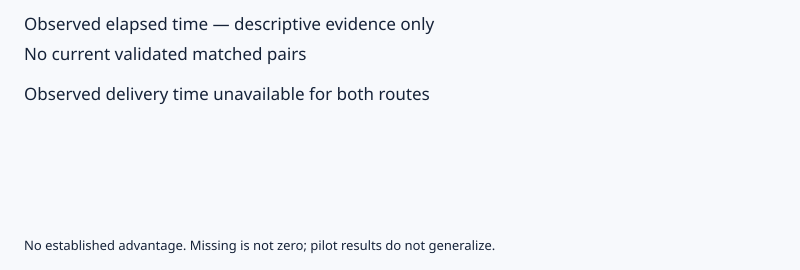
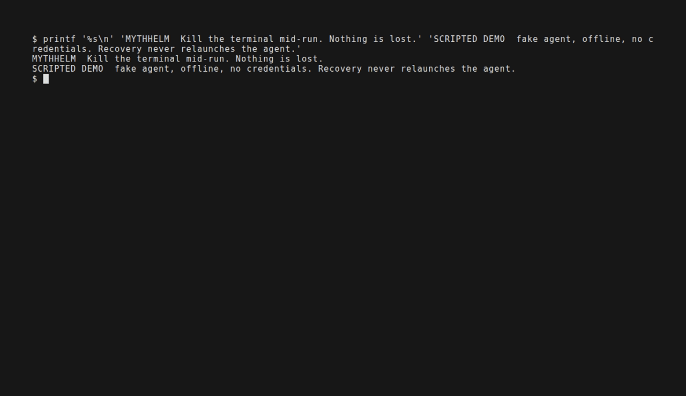
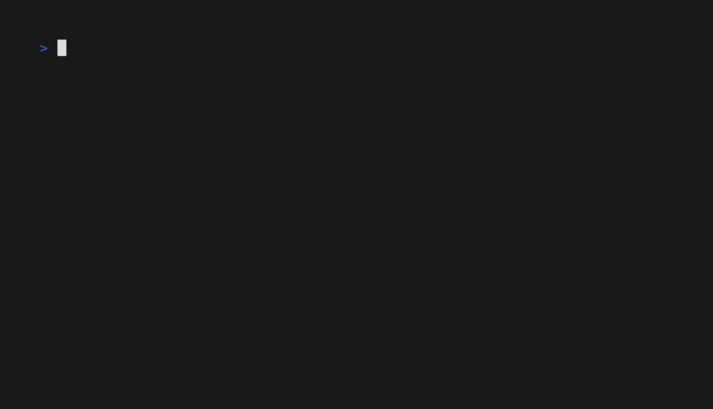
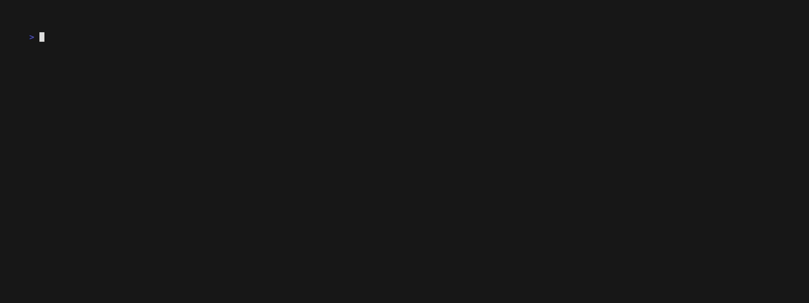

  <picture>
    <source media="(prefers-color-scheme: dark)" srcset="docs/assets/brand/lockup-on-dark.png">
    
  </picture>

**The open-source command deck for native coding agents.**

MYTHHELM is a pre-alpha project for coordinating native coding agents while preserving their harnesses. The implemented single-agent workflow and its limits are listed below; the broader multi-agent product and qualified Codex support remain unfinished.

> **Target: build and ship MYTHHELM at least 20× faster. Result: not demonstrated.** This is a development and delivery target for building MYTHHELM itself, not a claim of 20× product runtime or native-harness performance. The separate product goal is faster, cheaper and higher-quality delivery than vanilla native harnesses, with no assigned speedup factor; that advantage also remains unproven. Building and shipping can continue while fair comparisons are prepared. Specifications, PR counts and a scripted demo are not finished-product delivery.
>
> **Self-building status: native work is real; acceptance gaps remain.** At the fixed **2026-11-02 19:30 UTC snapshot**, an attachment response-queue native attempt had exited zero, but formatting failed and independent review found production and fixture defects. A second attempt was in flight, not accepted. The recording selector's [draft PR #576](https://github.com/turbokast/mythhelm/pull/576) also had newly reproduced behavior gaps despite passing fake-tool checks; [service fixture PR #573](https://github.com/turbokast/mythhelm/pull/573) remained blocked by Windows CI. Documentation and watchdog repairs [#571](https://github.com/turbokast/mythhelm/pull/571) and [#574](https://github.com/turbokast/mythhelm/pull/574) are merged. The [latest acceptance-gaps report](docs/dogfood/0013-acceptance-gaps.md) publishes actual aggregate measures and limits. The [earlier accepted maintenance pilot](docs/dogfood/0003-measured-self-hosting.md) included one matched pair with shorter direct-native execution; it established no advantage. The full product and 20× target remain unproven.

> **Service shell staging: a first status lookup can change the root.** `mythhelm supervisor status` starts the service when needed. Successful startup on a fresh state root initialises and adopts it. The existing local `run`, `recover` and `apply` paths then refuse that adopted root with `ownership_unresolved` (exit 6) until their service clients land. The shell currently serves authenticated status; `run.start` and `attachment.open` remain unsupported. See [service shell staging](docs/limitations.md#service-shell-staging).

> **Status: pre-alpha.** The only release so far, v0.0.1, is a source tag with no binary archives, so you build from source. The headless dogfood slice (`run`, `review`, `apply`, `recover`) plus an offline `demo` and a read-only `doctor` are implemented on `main` and covered by a packaged-binary end-to-end suite. `stop` and `runs list`, a budget ledger with finite run envelopes, execution profiles, a per-user supervisor and a one-way `migrate` have landed since, with the limits listed below and in the [limitations register](docs/limitations.md). A focused mission TUI is also implemented, with the evidence and limitations below. The broader adaptive product remains a design contract, not an implemented or benchmarked capability.

<!-- performance-report:start -->
## Native delivery performance

**Pilot / development: 1 assigned pairs; 1 independent component(s).** No comparative advantage is established.

Native harness: **claude-code**; PR scope: **validation-use** (authored via **direct-native**). This measures the PR validation workload, not general coding delivery.

| Route | Accepted within budget / assigned | Observed mean elapsed | Usage provenance / missingness | Paired trials |
|---|---|---|---|---|
| MYTHHELM | 1 / 1 | 170.61 s (1 observed; 0 missing) | 1 reported; 0 observed; 0 unknown | 1 |
| Direct native | 1 / 1 | 158.51 s (1 observed; 0 missing) | 1 reported; 0 observed; 0 unknown | 1 |

Outcomes, usage, provenance and limitations

All assigned outcomes (including failures and incomplete work):

| Route | accepted | rejected | error | timeout | blocked | unfinished | unstarted |
|---|---|---|---|---|---|---|---|
| mythhelm | 1 | 0 | 0 | 0 | 0 | 0 | 0 |
| direct-native | 1 | 0 | 0 | 0 | 0 | 0 | 0 |

Token totals remain separate; each cell shows total / missing assignments.

| Route | input_tokens | output_tokens | cache_read_tokens | cache_write_tokens |
|---|---|---|---|---|
| mythhelm | 6 / 0 | 1523 / 0 | 47565 / 0 | 7496 / 0 |
| direct-native | 6 / 0 | 1527 / 0 | 47994 / 0 | 7689 / 0 |

This PR: **validation-use** through MYTHHELM; authored via **direct-native**. Candidate source: `f36fb5f1d60b0bd1405490006aa2a8523f861621`; MYTHHELM tool source: `6a81f6036bab0fcc7410b03ff65d845763d33c3c`; reviewed native-use receipt: `713d294d95383bcf1b80577a2b6484c5988d7f5705c0bfe2f44e0a249a6e1051`.
Validation input: `76a609af2c530a2bf0fedaddf70751be4fe23a2c`; profile: **mythhelm.toml-only**; trial configuration SHA-256: `20680660d8aeb3d70edaa75de9e1aa46a520127ec1c979fd48fa51070d110c8c`. Only the trial mythhelm.toml differs; this is a reviewed validation profile, not identical full source.
The paired workload does not establish broader coding performance. Different workload sources are reference measurements. The comparison build identifies MYTHHELM under comparison; only the MYTHHELM arm executes it.

| Pair / route | Workload source | MYTHHELM comparison build | Reviewed native receipt SHA-256 |
|---|---|---|---|
| adoption-fixture-max-pair1 / mythhelm | `76a609af2c530a2bf0fedaddf70751be4fe23a2c` | `6a81f6036bab0fcc7410b03ff65d845763d33c3c` | `713d294d95383bcf1b80577a2b6484c5988d7f5705c0bfe2f44e0a249a6e1051` |
| adoption-fixture-max-pair1 / direct-native | `76a609af2c530a2bf0fedaddf70751be4fe23a2c` | `6a81f6036bab0fcc7410b03ff65d845763d33c3c` | `7e67d2ff86686883f44e44f917ee753ae7812c6ce44f94e1977374f08b1c24da` |

Registered time ceiling: 600 s per arm; one attempt per arm. Observed elapsed means include all outcomes with known time; missing time is excluded and counted, never zero. These are descriptive observations, not restricted-time scores or successful-run latency.

Native parity: harness `claude-code`, native_version `2.1.317`, model `claude-opus-5-5`, effort `xhigh`.
Registered: 2026-11-03T23:18:30.041397+00:00. Protocol: `c163a0ef6323886217ab1944287ea9b611df6b9628291b8589ab94b864bb7551`. Independent review: `1b5f16242ab0b785f8dfaeeed2a73039197e1d1c44d34b410dcdc515d639bc69`.
Source / task contract / checks SHA bindings: `76a609af2c530a2bf0fedaddf70751be4fe23a2c` / `a75f9d83e197b1f39ecf1cef25f6a1af7e99020de4071a752332fdd7b4f9afbf` / `80282ec86fbcedc3e3a7501fb3431c7ef01f339954a25118ca0332e2b6ae93e8`.
Configuration / environment SHA-256: `fe43898d65d1b82f7b0e5cb183a24fbf647863525def48b03e81a9dd2e8057e8` / `0493700c57d4443eaa7cb63a41bb10e5005cc1e9844420e1f0bb5fcc3181d9ca`.
Limitations: defect_observation_pending, defect_window_not_elapsed, pilot_not_confirmatory, single_dependent_component, validation_only_not_general_coding, safe_mode_trusted_host_broad_permissions, fixed_mythhelm_first_no_counterbalance, native_prefix_and_host_cache_uncontrolled, separate_empty_go_build_caches_paths_normalized, shared_module_preparation_excluded_from_timings, root_full_go_finished_before_pair, effort_configured_not_internally_observed, plugin_activation_not_certified_by_inventory, managed_remote_policy_uncertified, subscription_funding_declared_not_actual_charges, workspace_and_attempt_id_differences_disclosed, native_readonly_git_checks_differ, native_tool_timeout_settings_differ_untriggered, single_development_pair_no_superiority, prior_cohorts_and_rejected_authoring_not_pooled, earlier_quality_defect_observations_retained, actual_cross_platform_ci_still_required. A small pilot cannot establish population performance; independent components, delayed defects and uncertainty limit interpretation.

Same native harness, model, effort, source, task, checks, settings, environment and registered budget are required for current matched evidence. Historical [scheduling-confounded pilot](docs/dogfood/0003-measured-self-hosting.md) results are excluded. See the [measurement method](docs/harness/measured-delivery.md#controlled-comparisons).
<!-- performance-report:end -->

## Dogfood slice status

Supported now:

- Headless `mythhelm run --adapter fake|claudecode` with admission, supervision, verification, review, apply and recovery.
- `mythhelm demo`: a fully offline scripted run in a disposable repository; every screen is labelled `SCRIPTED DEMO`.
- `mythhelm doctor`: read-only prerequisite report; it writes nothing and prints no credential values. Its `qualification:` section lists each harness record with its progress, the failing columns and the next test that could advance it.
- `mythhelm stop <run-id>` and `mythhelm recover <run-id>`: a stop request that the run's worker acknowledges, and recovery of an interrupted run without relaunching native work. Both run locally from the CLI.
- `mythhelm runs list`: the runs in the local state, newest first.
- A budget ledger for every admitted run: usage rows labelled `reported`, `estimated` or `unknown`, one local quota reservation, and finite run envelopes (execution time, repairs, replans, transport retries) set with `--envelope-*` flags or `mythhelm.toml`. See the [user guide](docs/user-guide.md#budget-ledger).
- Execution profiles: `restricted` is the default. On Linux, where the boundary can be entered, it runs the native process in a user and mount namespace with a read-only root and a filtering proxy for network access. `--execution-profile trusted-host` opts out and is disclosed on every surface.
- `mythhelm supervisor status`: shows the per-user supervisor service's state, starting it if needed, over authenticated local IPC (Unix socket on Linux and macOS; the Windows named-pipe transport is tested, but lazy start has no Windows evidence). Runs are not routed through the service yet: `run`, `recover` and `apply` still hold a per-run owner lock.
- `mythhelm migrate`: preview, or apply with `--yes`, the move of a state directory to the v2 ledger. It is one-way; see "Not supported yet" for what it leaves refused.
- Linux and macOS; Windows amd64 and arm64 `scripted-child-process` lifecycle tests cover an experimental fake-process subset only. The Windows support matrix has no qualified rows; native Claude Code and Codex launch remain refused pending separate qualification. Worker crashes retain unresolved ownership and quarantine; launch inside a kill-on-close parent job is refused. Second interrupt and hosted console cases remain untested or blocked. See [Windows lifecycle evidence](docs/limitations.md#windows-lifecycle-evidence). Off Linux, scripted runs need `--execution-profile trusted-host` (the default `restricted` profile is refused there).
- Dogfood billing postures `local-scripted` and `subscription-declared` (user-declared, never verified by MYTHHELM).
- Codex is not yet a supported adapter: `--adapter codex` has fixture-tested adapter code only, its registry row stays `planned`, and every run blocks or is refused (see [Codex limits](docs/limitations.md#codex)).

Not supported yet:

- Plugins and routing: still planned. Releases: v0.0.1 is the only release and carries no binaries. The archive pipeline is implemented and dry-run proven on a test tag, but it has not published a release (see [the release process](docs/release-process.md)).
- Contained execution beyond Linux. On macOS and Windows `restricted` and `inspect` are refused with exit 7, and so are both for the Claude Code route on every OS (its credential boundary is not enforced yet), so real Claude Code runs need `--execution-profile trusted-host`. The Linux boundary does not block direct network egress or signals to same-user host processes.
- Using the supervisor service for runs. `stop` and `recover` are not served by it (#348).
- Life after root adoption (explicit `mythhelm migrate --apply --yes` or successful fresh supervisor startup): `run`, `recover` and `apply` are then refused with exit 6, and no command restores the backup (#320, #369). Do not apply the migration unless you accept that.
- `subscription-only`: it blocks today, because no live-qualified qualification record exists for any route.
- The AC-4.7 OAuth-token exception: unwired, refused at both gates (see [ADR 0002](docs/decisions/0002-dogfood-billing-posture.md)).
- macOS MDM preferences and remote cached managed policy as certified trust sources; the settings inventory covers files only.

Try it with no credentials and no network at runtime: `go run ./cmd/mythhelm demo` (the first build needs the Go module cache populated). `go run ./cmd/mythhelm doctor` reports what your machine still needs for a real run.

*Scripted recording, fake agent, offline, no credentials, rendered from `docs/demos/hero.tape`. It kills the foreground `mythhelm run` with SIGKILL while the scripted agent works: the worker and the agent are separate processes and survive, and `mythhelm recover` reattaches to the same worker and finishes the run without relaunching the agent. A hard-killed worker is a different case and is not shown (#391). The red kill marker is a shell annotation, not mythhelm output. Regenerate it with `docs/demos/record.sh`.*

*Honest recording of `mythhelm demo --check pass`, rendered from `docs/demos/demo.tape` — regenerate it with `docs/demos/record.sh`.*

*Honest recording of the TUI driving `mythhelm demo --check pass`, rendered from `docs/demos/tui.tape` — regenerate it with `docs/demos/record.sh` from the pinned revision (`docs/demos/manifest.json`), or with `docs/demos/record.sh --repin` from a clean tree.*

## TUI status

Supported now (evidence: [G09 record](docs/tui-slice-g09-evidence.md); unrecorded combinations are experimental per I14):

- The Observatory mission view on a TTY: `mythhelm run` / `demo` / `review` show NOW / NEXT, Tasks, Agent, Evidence and an inspectable Diff across wide, two-pane, single and compact layouts. Help, the command palette and confirmations open as overlays; small terminals use a full-screen overlay with a retained header. See [controls and exit behavior](docs/user-guide.md#the-terminal-view).
- Stable linear output without a TTY, under `TERM=dumb`, with `--plain`, and machine output (`--format jsonl`); `--accessible` emits the ordered screen-reader stream. Covered on Linux, macOS and Windows (x86_64 and ARM) by the packaged-binary end-to-end suite.
- `--theme auto|dark|light` selects Observatory (dark) or Paper (light); the palette can toggle them. `--colour`, `--motion` and `--icons` remain explicit overrides. Background detection is unqualified; matching the terminal background to the chosen theme is required for its contrast guarantees. See [theme selection and startup limits](docs/user-guide.md#themes-and-terminal-background).
- `q` offers selectable exit options, initially Back. With recorded detachment support and a running worker, Detach leaves execution running and exits 6 with a state-bound recovery command; Ctrl-C in a live executing run first requests a stop and keeps the view open. Stop remains requested until worker confirmation. Detached demos retain their repository and state for [recovery and explicit cleanup](docs/user-guide.md#recovering-a-detached-demo).

Recorded interactive combination (Revision 1.1 §16.4 row in the G09 record):

- GNOME Terminal 3.52 (VTE 0.76) + zsh 5.9 on Ubuntu 24.04, 190x45.

Experimental until recorded in the G09 record:

- Interactive use in any other terminal/shell: only the combinations with full evidence rows are claimed.
- Screen-reader support: no human session recorded yet, all combinations experimental (AC-5.4).

Known limitations (see the [current evidence and gaps](docs/tui-slice-g09-evidence.md#5-current-source-evidence-and-remaining-gaps)):

- The interactive row above and checked-in recordings describe their pinned historical builds. The Observatory renderer, overlays and theme flags have automated evidence ([PR #566](https://github.com/turbokast/mythhelm/pull/566), [#587](https://github.com/turbokast/mythhelm/pull/587), [#618](https://github.com/turbokast/mythhelm/pull/618)); the human G09 session has not been repeated. The new synthetic TUI recording awaits Task 20, real recording tools and artifact inspection.
- Windows detach remains unqualified and its deliberate control is disabled without recorded support. Verification/apply phases finish headless rather than accepting worker-stop cancellation; non-deadline fenced workers may still wait indefinitely for reconnection. Stale supervisor beats mean unknown supervision. Human screen-reader and light/dark terminal matrices remain missing.
- Mixed supervisor/worker binary handoffs fail closed. [Finish/drain old supervisors before replacing the binary](docs/user-guide.md#binary-replacement-and-existing-runs); seamless in-place replacement between admission and spawn is unsupported.

## Principles

We measure backlog delivery and require admitted MYTHHELM dogfooding where
available, with explicit fallback records when blocked. We have **not yet
established a comparative performance advantage**. See [benchmarks and
dogfooding](docs/benchmarks.md) for the evidence, metrics and publication criteria.
A [measured native run](docs/dogfood/0003-measured-self-hosting.md) has authored and
verified a repository maintenance change through MYTHHELM; its small comparison
does not establish a speed or quality advantage.

The next delivery focus is a [bounded validation cycle](docs/validation-plan.md)
for dependable single-agent delivery, with external repeat use and predefined
continue/simplify/stop criteria. Broader expansion waits for that evidence.

- **Native harnesses preserved.** MYTHHELM drives each agent through its own supported surface. It does not replace or impersonate it.
- **Your subscriptions, no billing surprises.** Work runs against the allowances you already have. Metered spend is never started silently.
- **Honest state.** Estimated, reported, observed and unknown values stay distinguishable everywhere.
- **Safe by default.** Repository text, model output and plugins cannot grant permissions, spend money or publish.
- **Entirely free.** The complete core, built-in adapters, TUI, headless mode, plugin SDK and local routing are free, with no paid tier, feature gate or required account.

## Design

The [specification index](docs/spec/README.md) identifies [Master Specification v2](mythhelm-synthesis/MYTHHELM_Master_Spec_v2.md) as the current design and preserves Revision 1.1 for historical references. The full vision combines native continuity, verified delivery, bounded parallel construction and evidence-gated adaptation. The first useful milestone is one qualified native route completing the task-to-verified-candidate loop. The [product adoption map](docs/spec/synthesis-adoption.md) connects all 16 implementation slices to the backlog.

Published user and contributor guides: <https://turbokast.github.io/mythhelm/>.

## Planned stack

Go core with a [Bubble Tea](https://github.com/charmbracelet/bubbletea) TUI, local SQLite state and a versioned process protocol for plugins.

## Contributing

Contributions are welcome, and you don't need a paid agent subscription to make a useful one. Read [CONTRIBUTING.md](CONTRIBUTING.md) first. All commits must be signed off under the [Developer Certificate of Origin](DCO).

- Questions and ideas: [GitHub Discussions](https://github.com/turbokast/mythhelm/discussions)
- Bugs: [issues](https://github.com/turbokast/mythhelm/issues/new/choose)
- Security vulnerabilities: see [SECURITY.md](SECURITY.md). Don't open a public issue.

## License

[Apache License 2.0](LICENSE). See [NOTICE](NOTICE).

MYTHHELM is an independent project. It is not affiliated with or endorsed by any agent vendor. Product names belong to their respective owners.
