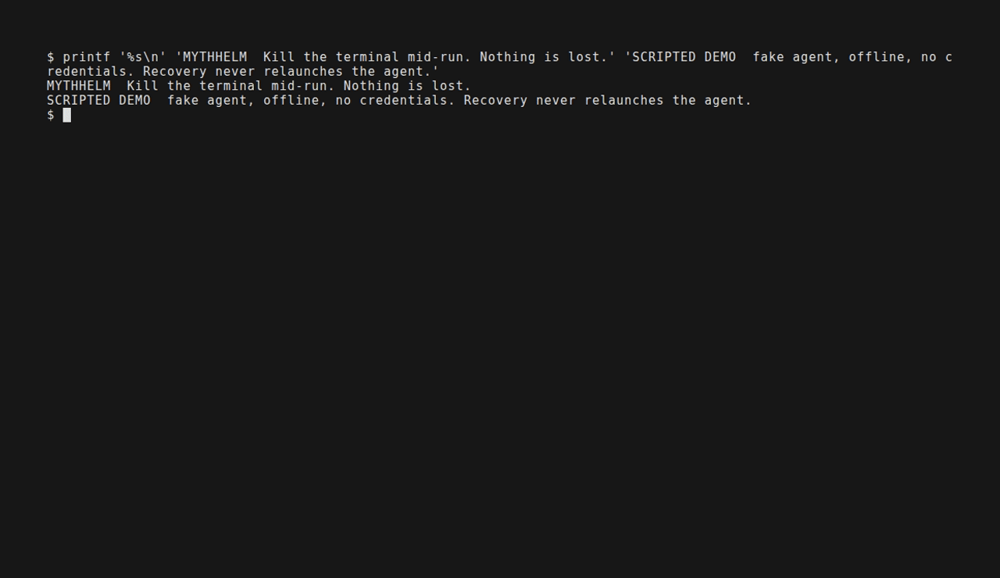
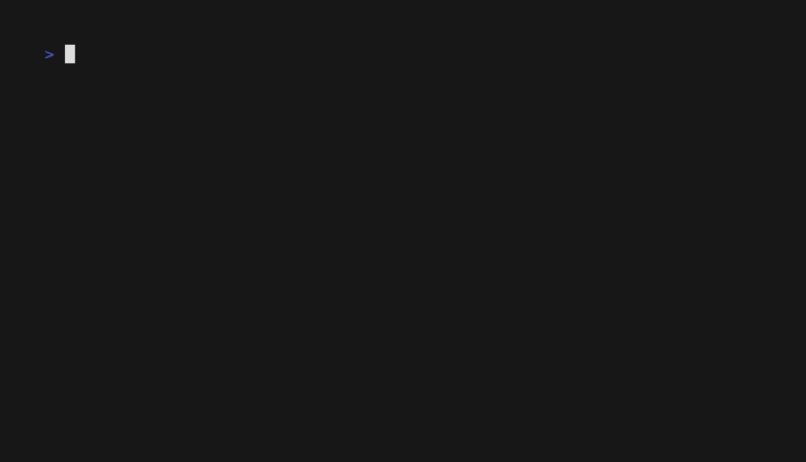

# User guide

MYTHHELM is the open-source command deck for native coding agents. This guide
covers installation, the scripted quickstart, running a task, acceptance
(what a verification verdict is bound to), stopping and recovering runs,
execution profiles, billing postures, the budget ledger and state migration. MYTHHELM is **pre-alpha**: the only release, v0.0.1, is a
source tag with no binary archives, so read
[Limitations]({{ site.baseurl }}/limitations.html) before relying on anything
here.

## Installation

There are no binary archives yet, so build from source. MYTHHELM needs Go 1.27
or newer. `go.mod` pins the toolchain, so with the default `GOTOOLCHAIN=auto`
an older `go` command downloads the right version the first time it runs.
Nothing else is required: no accounts, credentials or network services.

```sh
git clone https://github.com/turbokast/mythhelm.git
cd mythhelm
go run ./cmd/mythhelm version   # build and run the CLI
```

## Quickstart

The fastest way to see MYTHHELM work is the fully offline scripted demo. It
runs in a disposable repository, needs no credentials and no network at
runtime, and labels every screen `SCRIPTED DEMO`:

```sh
go run ./cmd/mythhelm demo
```


*Scripted recording, fake agent, offline, no credentials, rendered from `docs/demos/hero.tape`. It kills the foreground `mythhelm run` with SIGKILL while the scripted agent works: the worker and the agent are separate processes and survive, and `mythhelm recover` reattaches to the same worker and finishes the run without relaunching the agent. A hard-killed worker is a different case and is not shown (#391). The red kill marker is a shell annotation, not mythhelm output. Regenerate it with `docs/demos/record.sh`.*


*Honest recording of `mythhelm demo --check pass`, rendered from `docs/demos/demo.tape` — regenerate it with `docs/demos/record.sh`.*


*Honest recording of the TUI driving `mythhelm demo --check pass`, rendered from `docs/demos/tui.tape` — regenerate it with `docs/demos/record.sh` from the pinned revision (`docs/demos/manifest.json`), or with `docs/demos/record.sh --repin` from a clean tree.*

To check what your machine still needs for a real run, use the read-only
prerequisite report. It writes nothing and prints no credential values:

```sh
go run ./cmd/mythhelm doctor
```

## Running a task

`mythhelm run` runs one task through one native agent attempt, then freezes
the result as a candidate you can review and apply. This example uses the
scripted fake adapter, so it needs no credentials and no network:

```sh
mythhelm run --adapter fake --billing local-scripted \
  --task-file task.md --execution-profile trusted-host
mythhelm runs list
mythhelm review <run-id>
mythhelm apply <run-id> --to-branch mythhelm/demo
```

`--adapter`, `--billing` and `--task-file` are required, with no defaults. The
task file is Markdown and reaches the agent on stdin. Admission refuses the run
with exit code 3 and a reason code, rather than guessing, when:

- the checkout has uncommitted changes (`dirty_checkout`): commit them, or pass
  `--use-committed` (or `--rev <rev>`) to run on the committed revision;
- Git has no `user.name` and `user.email` (`git_identity_unavailable`);
- the revision has no `mythhelm.toml` with at least one `[[checks]]` entry
  (`no_checks_configured`): commit one, or pass `--no-checks`, which waives the
  checks and ends the run `ready_for_review (unverified)` with exit code 5;
- the committed `mythhelm.toml` is not trusted yet (`untrusted_project_config`):
  review it, then pass the digest the refusal prints as
  `--trust-project-config sha256:<digest>`;
- another run is still active (`active_run_exists`). One run at a time is
  allowed per state directory; created, admission, executing, verifying,
  applying, stopping, interrupted and recovering runs all count.

`mythhelm review <run-id>` prints the entitlement sentence, the verification
verdict, the candidate's validation flags, the check evidence, whether the
verdict still applies to the candidate (`Acceptance:`) and the candidate diff
(`--no-diff` omits the diff); see [Acceptance](#acceptance). `mythhelm apply`
creates a new local branch at the candidate commit and leaves your checkout
untouched. It needs `--to-branch`, plus `--accept-flags` when the candidate has
validation flags or `--accept-unverified` when its verdict is not bound to the
candidate (checks did not run, the verdict is stale, or it predates binding). It
applies only a run that is `ready_for_review`: a run that ended
`failed (verification_failed)` has no way to hand over its candidate yet
([#380](https://github.com/turbokast/mythhelm/issues/380)). The candidate commit
carries a `MYTHHELM-Run: <run-id>` trailer and your Git author, so rewrite it
before you publish it if that matters to you.

On a TTY, `run`, `review` and `demo` open the TUI. Without one, or with
`TERM=dumb`, the output is linear, and `run` also takes `--plain`,
`--format jsonl` and `--accessible`.

## Acceptance

MYTHHELM does not call a candidate verified because a check once passed. A
verdict is bound to what it judged, and `review` and `apply` ask whether it
still applies. This section describes the P1 flow as shipped: one native
session, one writer, project checks the candidate cannot edit. The outputs
below are from a synthetic fixture: the scripted fake route in a temporary
directory on the packaged binary, with no credentials in the environment. Run
IDs, commits, digests and paths differ on every run.

### What a verdict is bound to

When the project checks run, MYTHHELM records an attestation beside the
verdict. It names five things:

- the **candidate**: the frozen commit that was checked;
- the **contract**: the SHA-256 of the task file;
- the **check definitions**: the digest of the admitted `[[checks]]`;
- the **evaluator**: a digest over the check definitions, the containment
  boundary and its policy;
- the **environment**: a partial fingerprint of the operating system, the
  architecture, the verifier and the *names* of the check environment's
  variables. Variable values are never recorded, and the version of the tools
  the checks run (compiler, test runner) is unknown. The environment is
  recorded, not pinned: a live run's checks get the native's environment,
  including variables the adapter sets, and a run finished by `mythhelm recover`
  gets one rebuilt from the recovering process.

The attestation is stored immutably: no statement can update, delete or
replace it. The receipt shows its digests under `verification.binding`.

The check commands come only from the committed `mythhelm.toml` you trusted
with `--trust-project-config`. Edits in the candidate, the task text and agent
messages cannot change which commands run, their timeouts or the evaluator.
Admission also journals a policy pin, shown as `acceptance.policy_pin` in the
receipt: policy `P1` version 1 and its digest, the task and contract, the check
definitions and the evaluator; the check timeouts are listed under
`acceptance.bounds.check_timeouts`. A run admitted with
`--no-checks`, or under `inspect`, runs no check, so its pin leaves the
check-derived fields . If the evaluator that ran is not the pinned
one, the verdict is `INVALID`, never `passed`.

### Verdicts

| Label | Meaning | Run ends | Exit |
|---|---|---|---|
| `passed` | every admitted check passed and the binding was recorded | `ready_for_review` | 0 |
| `failed` | a check failed or timed out; an unavailable check never hides a failure | `failed (verification_failed)` | 5 |
| `NOT RUN` | no verdict was reached; the candidate is kept, unverified | `ready_for_review (unverified)` | 5 |
| `INVALID` | the evaluator that ran is not the pinned evaluator | `failed (verification_invalid)` | 5 |

Three endings carry no verdict label. A run whose acceptance pin cannot be
built or committed ends `blocked (acceptance_pin_failed)` before any worker
exists, with exit 3. A run whose pin cannot be read when its checks are due
ends `failed (acceptance_pin_unreadable)`, with exit 1. A verification that is
cancelled ends `failed (verification_unavailable)`, with exit 5.

`NOT RUN` always carries its reason, and it never renders as a verified run:

- `waived by --no-checks` and `checks_refused_under_inspect`: no check was
  run, by request or because `inspect` does not run them;
- `checks_unavailable`: a check could not start or gave no result (a missing
  executable, for example), and no check had failed. The candidate stays
  reviewable instead of being failed for a fault in the evaluator;
- `no_checks_ran`: the verdict had no check results to judge;
- `binding_unavailable`: the checks ran but the attestation could not be built
  (a bind error, or its 10 second limit);
- `record_unavailable`: `mythhelm recover` found the checks had returned but
  their verdict was never recorded, and recorded one from the journaled check
  results. It never re-runs the checks;
- `pin_missing`: the run was admitted by a build that recorded no pin and was
  recovered afterwards, so nothing was fixed at admission to compare with.

The other reasons are `checks_failed` for `failed`, and
`evaluator_pin_missing` or `evaluator_digest_mismatch` for `INVALID`.

A passing run, from the packaged binary on the fixture. The last lines of the
`run` stream, then `review` and `apply`:

<!-- Output of: mythhelm run --task-file task.md --adapter fake --billing local-scripted --execution-profile trusted-host --non-interactive --trust-project-config sha256:<digest> --plain (the P1 flow of TestE2EP1FlowNoCredentials), last 11 lines. -->
```text
run: verifying
verification: started
check e2e: passed
verification: passed
run: ready_for_review
receipt.written
usage: retail-equivalent unknown unknown (unknown, unknown)
reserve: verify pass (1 checks, 30s) + 3 repairs (estimate, not a reserve of provider quota)
remaining: unknown
next retry: none (used 0 of 3)
result: ready_for_review; exit 0
```

<!-- Output of: mythhelm review <run-id> --no-diff, on the run above (TestE2EP1FlowNoCredentials asserts its Verification and Acceptance lines). -->
```text
Run: run_01M4QFD9WP6C3NCK74VP98R0GV
State: ready_for_review
Task: Example task
Candidate: 197a6ee38df1a325f3126780858015d405d2681a
entitlement: not applicable (local-scripted: no inference, no network)
Verification: passed (bound to 197a6ee38df1a325f3126780858015d405d2681a)

Flags:
  none
Checks:
  e2e: passed (evidence: /tmp/mh-doc-pass/state/runs/run_01M4QFD9WP6C3NCK74VP98R0GV/evidence/197a6ee38df1/e2e.log; sha256: e3b0c44298fc1c149afbf4c8996fb92427ae41e4649b934ca495991b7852b855)
Acceptance: bound
```

<!-- Output of: mythhelm apply <run-id> --to-branch accepted, on the run above (TestE2EP1FlowNoCredentials). -->
```text
Applied run run_01M4QFD9WP6C3NCK74VP98R0GV to branch accepted at 197a6ee38df1a325f3126780858015d405d2681a
```

When a check cannot start, the candidate is kept and honestly unverified. The
fixture's check names an executable that does not exist, so `run` exits 5:

<!-- Output of: mythhelm run --task-file task.md --adapter fake --billing local-scripted --execution-profile trusted-host --non-interactive --trust-project-config sha256:<digest> --plain, with a check whose executable does not exist (TestE2EUnavailableChecksKeepCandidate), last 11 lines. -->
```text
run: verifying
verification: started
check e2e: unavailable
verification: NOT RUN (checks_unavailable)
run: ready_for_review (unverified)
receipt.written
usage: retail-equivalent unknown unknown (unknown, unknown)
reserve: verify pass (1 checks, 30s) + 3 repairs (estimate, not a reserve of provider quota)
remaining: unknown
next retry: none (used 0 of 3)
result: ready_for_review (unverified); exit 5 verification_unavailable
```

<!-- Output of: mythhelm review <run-id> --no-diff, on the run above (TestE2EUnavailableChecksKeepCandidate asserts both lines). -->
```text
Run: run_01M4QFE8AJZ6ZDN94155898ZR8
State: ready_for_review
Task: Example task
Candidate: 90c36add7f85c246bdbc5033a67fca6e01471e74
entitlement: not applicable (local-scripted: no inference, no network)
Verification: NOT RUN (checks_unavailable)

Flags:
  none
Checks:
  e2e: unavailable (evidence: /tmp/mh-doc-unavailable/state/runs/run_01M4QFE8AJZ6ZDN94155898ZR8/evidence/90c36add7f85/e2e.log; sha256: e3b0c44298fc1c149afbf4c8996fb92427ae41e4649b934ca495991b7852b855)
Acceptance: unverified (checks_unavailable)
```

A waived or unverified run shows its reason on both the `Verification:` line
and the `Acceptance:` line. A run admitted with `--no-checks` prints
`Verification: NOT RUN (waived by --no-checks)` and
`Acceptance: unverified (waived by --no-checks)`, and its receipt prints
`verification.binding` and `acceptance.overhead_ms` as , each with its
reason.

### Review and apply

`review` prints two verdict lines that answer different questions.
`Verification:` is what the receipt recorded when the run ended: `passed (bound
to <commit>)`, `NOT RUN (<reason>)`, `INVALID (<reason>)`, `failed` or
`unknown (<reason>)`. `Acceptance:` is read from the journal when you run
`review`, and says whether that verdict still applies to the candidate now:

| `Acceptance:` | Meaning |
|---|---|
| `bound` | the verdict passed and the candidate, contract, check definitions and evaluator still match |
| `unverified (<reason>)` | the verdict is `NOT RUN`, or the run has no verification (`no verification recorded`) |
| `STALE (changed: <dimensions>); re-evaluation required` | the verdict passed, but a bound dimension changed since: `candidate`, `contract`, `check_definition` or `evaluator` |
| `unbound (<reason>)` | the verification was recorded before acceptance binding existed |
| `rejected (<reason>)` | the verdict is `failed` or `INVALID` |

The environment is recorded and bound, but it is not compared when you apply:
moving the state directory or upgrading the binary changes no input to the
verdict. Unreadable verdict evidence (a passed verdict with no attestation, a
damaged candidate commit) is an error, exit 1, never a guess.

Because `Verification:` comes from the receipt and `Acceptance:` from the
journal, they can disagree. After the run's recorded task file changed, the
fixture shows:

<!-- Output of: mythhelm review <run-id> --no-diff, after rewriting the file runs/<run-id>/task.md in the state directory, as TestE2EStaleVerdictBlocksApply does. -->
```text
Run: run_01M4QFEM5E9QE9R3ZW12QD7RHJ
State: ready_for_review
Task: Example task
Candidate: a4c5d5280095f5e5b8d60c3bd4f2186d25921135
entitlement: not applicable (local-scripted: no inference, no network)
Verification: passed (bound to a4c5d5280095f5e5b8d60c3bd4f2186d25921135)

Flags:
  none
Checks:
  e2e: passed (evidence: /tmp/mh-doc-stale/state/runs/run_01M4QFEM5E9QE9R3ZW12QD7RHJ/evidence/a4c5d5280095/e2e.log; sha256: e3b0c44298fc1c149afbf4c8996fb92427ae41e4649b934ca495991b7852b855)
Acceptance: STALE (changed: contract); re-evaluation required
```

`apply` takes the same decision. It refuses with exit 3 unless the verdict is
bound, and every refusal names `--accept-unverified`, the only way past it:

<!-- Output of: mythhelm apply <run-id> --to-branch refused, on the NOT RUN run above (TestE2EUnavailableChecksKeepCandidate asserts exit 3). -->
```text
mythhelm apply: apply blocked: unverified candidate requires --accept-unverified (NOT RUN: checks_unavailable)
```

<!-- Output of: mythhelm apply <run-id> --to-branch refused, on the stale run above (TestE2EStaleVerdictBlocksApply asserts exit 3 and "changed: contract"). -->
```text
mythhelm apply: apply blocked: verification does not apply to the candidate (changed: contract); re-evaluation is required; --accept-unverified applies it without verification
```

An unbound verification is refused the same way
(`verification was recorded before acceptance binding existed;
--accept-unverified applies it without verification`). No command re-evaluates
a stale or unbound run in this release: start a new run, or apply with
`--accept-unverified`, which applies the candidate without verification. When
you do, the receipt records it as `acceptance.apply_override` (`state`,
`reason`, `changed`), while `verification.label` keeps describing the verdict as
recorded. An apply interrupted after it journaled its intent skips this check
when it resumes, so a resumed apply records no override
([#418](https://github.com/turbokast/mythhelm/issues/418)).

### The entitlement sentence

Every run states what MYTHHELM did and did not check about the route's
entitlement, on the same line wherever it appears. The line comes from the
admitted billing posture:

| Posture | Sentence |
|---|---|
| user-declared (`--billing subscription-declared`) | `entitlement: user-declared, NOT verified by MYTHHELM; paid continuation: unknown (user declares disabled)` |
| scripted (`--billing local-scripted`) | `entitlement: not applicable (local-scripted: no inference, no network)` |
| qualified route (strict `subscription-only`) | `entitlement: verified by MYTHHELM (<entitlement source>); paid continuation: <value>` |
| anything else, including an inconsistent posture | `entitlement: unknown` |

<div class="declared-note" markdown="1">
<span class="declared-note-label">declared, not verified</span>

A declared run says in so many words that MYTHHELM did not verify the
declaration and does not claim paid continuation is prevented. The qualified
sentence prints fields of the admitted posture; it does not name the
qualification record consulted, because admission does not journal that. No
route is live-qualified yet, so every strict run blocks today and no run
prints the qualified sentence.
</div>

The sentence appears in the `run` stream's admission block (indented two
spaces), as its own line in `review` and in the `--accessible` summary, in the
TUI status strip and in the receipt as `billing.entitlement_statement`. On the
fixture's admission block:

<!-- Output of: mythhelm run ... --plain (as above), last three lines of the admission decision block (TestE2EScriptedRunEntitlementNotApplicable asserts the receipt value; TestE2EDeclaredClaudeRunCarriesSentence asserts the declared line in this block). -->
```text
  execution profile: trusted-host, runs with your host authority and is not adversarially contained
  billing: local-scripted (qualified: false)
  entitlement: not applicable (local-scripted: no inference, no network)
```

The accessible stream's summary is a snapshot taken when the stream opens, so
for a live `run --accessible` it reads `entitlement: unknown` until admission
has decided. The admission event is then followed by the sentence in full on a
line of its own, because the event line is capped at 200 cells and can be cut
before it.

### The receipt

`mythhelm review <run-id> --format jsonl` prints the receipt as one JSON
object. Acceptance adds these keys:

| Key | Content |
|---|---|
| `verification.result`, `.label`, `.reason` | the stored verdict, its label (`passed`, `failed`, `NOT RUN`, `INVALID` or `unknown`) and its reason |
| `verification.binding` | `candidate` (`format`, `value`), `contract`, `check_definition`, `evaluator`, `environment` and `attestation_digest`, each digest as `sha256:<hex>`;  when no attestation exists |
| `acceptance.status` | the gate's answer when the review ran, not the stored verdict: `state` (`bound`, `stale`, `unbound`, `unverified` or `rejected`), its `reason` and, for `stale`, the `changed` dimensions (`candidate`, `contract`, `check_definition`, `evaluator`); `verification.label` still shows the stored verdict |
| `acceptance.policy_pin` | the P1 pin, or  |
| `acceptance.determinism` | `confined_to` and `note`, below |
| `acceptance.overhead_ms`, `.overhead_covers` | how long the binding step took, and `binding step` |
| `acceptance.bounds` | the bounds table below |
| `acceptance.apply_override` | present only after an apply over a verdict that was not bound |
| `billing.entitlement_statement` | the sentence above |
| `unknown_reasons` | one reason for every  leaf, keyed by its path |

A field MYTHHELM could not observe prints  with its reason in
`unknown_reasons`, never `0` or an invented value. A verification recorded
before acceptance binding existed prints its binding, pin and overhead as
 with that reason.

**Determinism.** The same pinned revisions (candidate, contract and check
definitions) produce the same verdict. Non-determinism is confined to the
native session, to the checks' own behaviour and to the check environment,
which is recorded but not pinned: a run that `mythhelm recover` finishes after
a supervisor crash rebuilds it from the recovering process, so it can bind a
different `environment` fingerprint from a run that never crashed. The receipt
says so in `acceptance.determinism`:

<!-- Excerpt of the output of: mythhelm review <run-id> --format jsonl, on the passing fixture run above (TestE2EP1FlowNoCredentials reads the receipt's acceptance keys). -->
```text
"determinism":{"confined_to":"native session","note":"acceptance inputs (candidate, contract, check definitions) are pinned; the check environment is recorded as a fingerprint and is not pinned, so a run recovered after a supervisor crash can bind a different one; each admitted check runs once with no retry; a check's own determinism is not asserted"}
```

A check that fails one run and passes the next is not detected, and no seed or
repetition is recorded.

**Bounds.** The receipt records the bounds the run was admitted under and says
which of them MYTHHELM enforces:

<!-- Excerpt of the output of: mythhelm review <run-id> --format jsonl, on the passing fixture run above (TestReceiptBoundsEnforcedFlags pins the flags). -->
```text
"bounds":{"check_timeouts":{"e2e":"30s"},"evidence_bytes_per_check":1048576,"execution_seconds":{"enforced":true,"value":1800},"repairs":{"enforced":false,"value":3},"replans":{"enforced":false,"value":2},"transport_retries":{"enforced":false,"value":5}}
```

`execution_seconds`, `repairs`, `replans` and `transport_retries` are the
envelope the run was admitted under (the built-ins here), each with whether
MYTHHELM enforces it. `check_timeouts` are the admitted per-check timeouts and
`evidence_bytes_per_check` is the evidence cap of each check; the check runner
applies both. The repair, replan and transport-retry ceilings bind no live run
([#328](https://github.com/turbokast/mythhelm/issues/328)), so the receipt
flags them `enforced: false`.

**Overhead and step limits.** Binding is limited to 10 seconds, recording the
verdict, rendering a receipt and the apply or review check each to 30 seconds.
Only the binding step's duration is recorded as `acceptance.overhead_ms`;
recording and rendering cannot measure themselves.

### The JSONL event contract

`run` and `recover` with `--format jsonl` print only documented events: the 29
types that `supervisor.StreamEventTypes` lists and a test pins, 28 journal event
types and the renderer's own `run.result`. A `verification.completed` payload
carries `result` (the verdict: `passed`, `failed`, `unavailable` or `invalid`,
or `NOT RUN` on a skip), and `reason` and `attestation_digest` when it has
them. An event outside the set is not printed: the command exits 1 with category
`undocumented_event` when nothing else failed, and otherwise keeps its own exit
code and names the event type on stderr.

### Known limits

Acceptance has residual limits, listed with the rest in
[Acceptance limits]({{ site.baseurl }}/limitations.html#acceptance-limits).
Two apply to what you see here: the TUI and `--accessible` views decide
"verified" from the candidate commit alone, so they can show a stale verdict as
verified while `apply` refuses it
([#393](https://github.com/turbokast/mythhelm/issues/393)), and the apply
override above can be lost across a crash
([#418](https://github.com/turbokast/mythhelm/issues/418)).

## Execution profiles

`--execution-profile` sets how much host authority the native process gets:

- `restricted` is the default. It runs the native, and the project checks, in a
  boundary: a user and mount namespace with a read-only root, only the working
  directory writable, no capabilities, ambient credential files unreachable and
  network access routed through a worker-owned filtering proxy.
- `inspect` is `restricted` with a read-only working directory. Its project
  checks are not run, so the candidate stays unverified.
- `trusted-host` runs with your host authority. Every surface states it
  verbatim: `runs with your host authority and is not adversarially contained`.

The boundary exists on Linux only, and only where the runtime probe can enter
it (it needs the host to allow unprivileged user and mount namespaces).
When it cannot be entered, admission does not fall back to your host authority:
it refuses with exit code 7 and `execution_profile_unavailable`, naming the
reason, and tells you to pass `--execution-profile trusted-host` if you accept
running uncontained. The same refusal applies on macOS and Windows, which have
no qualified boundary, and to the Claude Code route on every OS, where the
refusal reads `missing coverage: credential` because native authentication is
not yet bound into the boundary. Today a real Claude Code run therefore needs
`--execution-profile trusted-host`.

The Linux boundary has two stated gaps. The proxy is pinned through
`HTTPS_PROXY` and `HTTP_PROXY`, so the native can unset them: direct network
egress is not blocked. There is no PID namespace, so signalling other processes
of the same user on the host is not blocked either.

## Stop, recover and list runs

`mythhelm stop <run-id>` writes a stop request for the run's worker, after
checking that the worker is the one recorded for the run. It returns at once.
The worker owns the signalling and climbs the stop ladder pinned when the run
was admitted (for Claude Code, SIGTERM and then SIGKILL, each with a grace
period), then journals what it sent and which processes it could not resolve.
The command prints `stop requested — waiting for worker confirmation` until the
worker confirms, and `stopped — worker confirmed no remaining processes` once
it has. A stop request is not a confirmed stop: if the worker cannot show that
the process group and its descendants are gone, the run is not reported
stopped. In a foreground run without the TUI, the first Ctrl-C requests a stop
and the second detaches, printing `stop not yet confirmed; run 'mythhelm recover <run-id>'` and exiting with code 6.

`mythhelm recover <run-id>` takes over a run whose supervising process went
away, without launching any native work. It takes the run's owner lock,
verifies the worker's identity (PID, start time and launch nonce, never the PID
alone) and then does one of three things: reattach to a live worker, finish
freezing and verifying a run whose native result was already recorded, or
quarantine a lost worker. A quarantined run ends `interrupted` and `recover`
exits with code 6, `ownership_unresolved`, because MYTHHELM will not guess
whether the native is still writing. A quarantined run counts as active, so it
blocks every later run, and no command resolves a worker that was killed
outright yet ([#391](https://github.com/turbokast/mythhelm/issues/391)).

Both commands run locally from the CLI. The supervisor service does not serve
them in this build ([#348](https://github.com/turbokast/mythhelm/issues/348)),
and neither authorises its caller beyond the owner-only (0700) state
directory; a per-run capability token is a follow-up
([#356](https://github.com/turbokast/mythhelm/issues/356)).

`mythhelm runs list` prints the runs in the local state, newest first, as a
table of run, state, adapter, update time and repository. `--limit N` (default
20) bounds it and `--format jsonl` prints one `run_row` object per run,
including its billing posture and execution profile. It opens the database
read-only and creates nothing.

## Supervisor

`mythhelm supervisor status` prints the per-user supervisor service's process
ID, generation, state root and endpoint, starting the service first if it is not
running:

```text
pid:        <pid>
generation: <n>
root:       <state directory>
endpoint:   <socket path>
```

There is one supervisor per user. It starts lazily as a detached
`mythhelm __supervisor` process and keeps running after the command that started
it exits. It has no idle shutdown and no service registration, so stop it with
an ordinary signal. Control is a private local socket with a same-user peer
check (a Unix socket on Linux and macOS, a named pipe on Windows); no network
listener exists. A supervisor that serves one state directory refuses to be used
for another. The Windows pipe transport is covered by tests, but lazy start has
only Linux and macOS evidence.

The service holds the ledger's sole writer, reservations and idempotent
intents, but runs do not go through it yet: `run`, `recover` and `apply` still
take a per-run owner lock. Its decisions are in
[ADR 0014](https://github.com/turbokast/mythhelm/blob/main/docs/decisions/0014-service-topology.md).

## Exit codes

| Code | Meaning |
|---|---|
| 0 | Succeeded |
| 1 | Unexpected internal error, including an unreadable acceptance pin |
| 2 | Invalid arguments or configuration |
| 3 | Admission, policy or approval blocked, including a run that ends `blocked` |
| 4 | Native execution failed |
| 5 | Verification failed, invalid or unavailable (`--no-checks` ends here) |
| 6 | Interrupted, recovery required or ownership unresolved |
| 7 | A required adapter, platform or boundary capability is unavailable |
| 130 | Foreground cancellation completed |

With `--format jsonl` the result object carries the exit code and an error
category such as `admission_blocked` or `ownership_unresolved`.

## Doctor

`mythhelm doctor` is a read-only prerequisite report: it writes nothing,
creates no state and prints no credential values. Its last section,
`qualification:`, lists each harness record in the qualification registry
as one row and a next-test line, one row per seeded harness (this excerpt
shows one of seven):

```text
qualification:
claude-code × unknown: blocked (fidelity unknown, entitlement unknown, lifecycle unknown) [evidence 1 revs, latest none; drift clean] failing: fidelity, entitlement, lifecycle
  next_test: Prove included-only entitlement across the AT-03 routes with authorised tests; authority: maintainer allowance (MH-12)
```

Each row reads `<harness> × <surface>: <progress> (fidelity <v>,
entitlement <v>, lifecycle <v>) [evidence <n> revs, latest <ev-id>; drift <state>]`: the qualification progress (`planned`, `blocked`, `unsupported`
and the other honest labels), the three independent column verdicts
(`proven`, `not-proven` or `unknown`), how many evidence revisions the
record holds, the latest evidence id, and the drift state (`clean`, or the
reason the pinned binary or configuration no longer matches). A row ends
with ` failing: <column>[, <column>]` naming every column that is not
`proven`, in the order fidelity, entitlement, lifecycle; a column with no
verdict yet counts as failing, and a row whose three columns are all proven
has no `failing:` text. The line below each row, `  next_test: <text>`, is the
next test that could advance that record and the authority it needs.

When the state directory cannot be read the section says so instead of
guessing — `qualification: unavailable (<reason>)` — and an existing but
still empty registry reads `qualification: (no records)`. With
`--format jsonl` the same records appear under `qualification.records`,
each with its progress, per-column verdicts and evidence ids, evidence
revision count, drift triggers and next test.

## Billing

`mythhelm run --adapter claudecode` requires `--billing` and has no default.
Two postures apply to a native Claude Code subscription login, and they prove
different things. The posture is recorded on the admission row, the journal,
the receipt and `mythhelm runs`.

**`--billing subscription-only` (strict).** The run is admitted only when the
qualification registry holds a live-qualified record for this exact route, and
that record's entitlement evidence and stop-at-exhaustion capability are both
unexpired at admission. Any other qualification outcome blocks with exit code 3 and a reason in
the output (an operational error, such as an unreadable registry, instead uses
its normal exit code):

- `no_qualification_record`: the registry has no record for this route.
- `entitlement_not_proven`: the record is not live-qualified (for example it is
  fixture-only), its entitlement is unproven or expired, or the effective
  managed policy has a source MYTHHELM cannot yet inventory.
- `stop_at_exhaustion_unproven`: the record cannot show the run stops, rather
  than charges, when the allowance is exhausted.
- `ambiguous_qualification_match`: more than one record matches the route.
- `qualification_drifted`: the executable, configuration or account class
  changed since the record was earned. Run `mythhelm doctor` to inspect it.

Strict ignores any entitlement declaration. A matching record admits only on an
exact match of the route's authentication category, provider endpoint, workspace
class, effort settings and model snapshot, together with its harness, surface,
OS, architecture, trust profile, entitlement class and adapter protocol. No live-qualified record has been
recorded yet, so every strict run blocks today.

**`--billing subscription-declared`.** For personal use, you declare your plan
and that you checked extra usage is disabled:

```sh
mythhelm run --adapter claudecode --billing subscription-declared \
  --declare-entitlement plan=pro,extra-usage=disabled \
  --execution-profile trusted-host ...
```

`--execution-profile trusted-host` is needed today because the default
`restricted` profile is refused for the Claude Code route (see
[Execution profiles](#execution-profiles)).

<div class="declared-note" markdown="1">
<span class="declared-note-label">declared, not verified</span>

The declaration is user-declared, never verified: MYTHHELM does not check it,
and the run is labelled `entitlement: user-declared, NOT verified by MYTHHELM;
paid continuation: unknown (user declares disabled)`. It does not claim that
paid continuation is prevented. The same sentence appears on the run stream,
`review` and the receipt; see [Acceptance](#the-entitlement-sentence). A declared run still needs a first-party
subscription login, and the declaration is bound to that account and
configuration directory, so a changed account needs a fresh declaration.
</div>

`--billing local-scripted` is the offline posture; Claude Code refuses it. The
decisions behind both postures are in
[ADR 0002](https://github.com/turbokast/mythhelm/blob/main/docs/decisions/0002-dogfood-billing-posture.md) and
[ADR 0012](https://github.com/turbokast/mythhelm/blob/main/docs/decisions/0012-strict-subscription-admission.md).

### Budget ledger

Every admitted run keeps a budget ledger in the journal: typed usage rows
recorded when available, one quota reservation, one envelope row and, when an
allowance runs out, one exhausted bucket. A run refused at admission — for
example when its reservation hold fails — leaves no ledger rows. The ledger records what was observed and what was decided. It never
claims a provider balance, a remaining quota or a price that was actually
charged; anything MYTHHELM did not observe is reported as , never as
zero.

**Usage rows.** Each native result projects into typed usage rows keyed by
scope, unit and source (for example per-model token counts and a
retail-equivalent cost). Every row carries a label:  for exact
observed totals,  for totals built from identity-less deltas or
converted money, and  for scopes with no usable reading. The receipt's
`billing.usage_observations` lists each row with its scope, unit, source,
label and quantity, and retail rows add the note `estimate, not a charge`.
After a run, MYTHHELM prints one `usage:` line per row, for example
`usage: retail-equivalent unknown unknown (unknown, unknown)` when the adapter
surfaced no usage. A fake-adapter run records only that retail 
marker.

**Remaining and next retry.** The receipt's `billing.remaining` is always
`{quantity: unknown, bucket}`, and the CLI prints `remaining: unknown`:
MYTHHELM cannot see provider-side quota, so it reports nothing. When a run
exhausts its allowance, `billing.next_retry` and the `next retry:` line show
the operator retry schedule (`at`, `retries_used`, `retries_max: 3`); a run
that never exhausted renders `next retry: none (used 0 of 3)`. These lines
print on the linear, jsonl and demo paths only, not in the full-screen TUI.

**Envelopes.** Every admitted run carries an envelope: ceilings for execution
time, repairs, replans and transport retries. The built-ins are 30 minutes, 3
repairs, 2 replans and 5 transport retries. Per-run flags override them:

```sh
mythhelm run --envelope-execution 45m --envelope-repairs 5 ...
```

`--envelope-execution` takes a positive duration; `--envelope-repairs`,
`--envelope-replans` and `--envelope-transport-retries` take counts. A
`[envelopes]` table in `mythhelm.toml` sets the middle layer
(`execution = "45m"`, `repairs = 5`, `replans`, `transport_retries`), decoded
strictly: unknown keys, invalid durations and negative counts refuse admission.
The file is read only for runs that admit checks: a `--no-checks` run ignores
the `[envelopes]` table and uses flags and built-ins.
Precedence is flags, then file, then built-ins. Launches past a ceiling are
refused and the run becomes `blocked` with a reason naming the exhausted
kind (`envelope_repairs_exhausted`, `envelope_replans_exhausted`,
`envelope_transport_retries_exhausted`, `envelope_deadline_exceeded`).
Each S1 run launches a single attempt, so only the execution ceiling stops a
live run, whether the launching supervisor or `mythhelm recover` is watching
it; the repair, replan and transport-retry ceilings are checked at launch only
(#328). Extending a run requires a recorded user or standing-grant decision;
S1 can record only the `run.extension_granted` user decision, no command
records one yet, and a `blocked` run is not relaunched by `mythhelm recover`
(#329). Flags and configuration changes cannot raise a ceiling mid-run.

**Completion reserve.** Before dispatching a material replan after the first
verification, MYTHHELM checks that the execution time left covers one more
verification pass, and a dispatched replan then runs under a derived deadline
— the execution deadline minus the verify-pass timeout sum — so the reserve
survives the replan. The `reserve:` line and the receipt's `billing.reserve`
show this estimate (`verify pass (...) + N repairs`), labelled
`estimate, not a reserve of provider quota`. It is planning arithmetic, not a
claim on provider capacity; repairs are never gated by it. For a checked run
the receipt's verify pass is the sum of the check timeouts the pin journaled at
admission, the same values as `acceptance.bounds.check_timeouts`. It reads
, with the reason in `unknown_reasons`, for a run whose pin is
missing (admitted before the pin existed), unreadable or never journaled, and
for a pinned timeout that is not a positive duration (the count stays known,
the sum does not).

**Exhaustion.** When the allowance is exhausted, the run keeps its frozen
candidate and session artifacts, ends `blocked` with reason
`allowance_exhausted`, and records the bucket. While the bucket row is live,
new runs on the same bucket are refused with `allowance_exhausted`; the
operator may retry on the recorded schedule (backoff 1m, 5m, 15m, then stop
when the reset is unknown, at most 3 retries), and MYTHHELM itself launches
nothing automatically. Once the 3 retries are spent the bucket refuses new
runs for good: S1 records no reset, so nothing clears the row and no command
does either (#327, awaiting a maintainer decision). The run's reservation is
released only after the attempt reaches terminal state.

The exhaustion signal is synthetic. The Claude Code decoder recognises it from
a fixture shape (`allowance_exhausted`) that no recorded native run has
produced; on a real route an exhausted allowance surfaces as a provider-limit
or billing error and the bucket is not recorded.

**Reservations.** Admission holds exactly one quota reservation coupled to the
run's bucket, with quantity . The reservation is
`local coordination only — not provider availability`: it coordinates
MYTHHELM's own runs and says nothing about what the provider will serve.

The billing, persistence and process-ownership decisions behind the ledger are
in
[ADR 0015](https://github.com/turbokast/mythhelm/blob/main/docs/decisions/0015-budget-ledger-s1.md).

## Migrating an existing state directory

**Do not run `mythhelm migrate --apply --yes` unless you accept its
consequences.** The supervisor service does not serve runs yet, so once the
migration reaches phase `adopted`, `mythhelm run`, `recover` and `apply` are
refused with `ownership_unresolved` (exit 6) naming the phase, and no command
restores the backup. `review`, `runs list` and `stop` keep working. Preview is
always safe.

`mythhelm migrate` brings a state directory written by the legacy per-run
writer onto the v2 ledger. `mythhelm migrate --preview` (the default)
prints the plan, the runs to import and the owners to drain, using no
credentials and no network, and writes nothing. `mythhelm migrate --apply
--yes` repeats the preview, then drains the legacy run owners (an owner
still holding its lock at the deadline stops the migration with
`ownership_unresolved`, exit 6), takes a backup next to the ledger as
`mythhelm.db.bak-migration-v8` with a `.json` sidecar, and imports every
legacy run as a one-task run. Imported runs keep their IDs, billing
posture and evidence, and stay unverified. Without `--yes`, `--apply`
prints the preview and writes nothing.

Preview, including `--apply` without `--yes`, takes no migration locks
and writes nothing. Once `--apply --yes` starts the migration, it holds
the instance and state-directory locks, and each run's owner lock from
the drain through backup, import and adoption, so the legacy `run`,
`recover` and `apply` commands refuse while those locks are held. The
`previewed` phase does not refuse legacy commands by itself: a migration
interrupted before it records `drained` leaves the phase at `previewed`,
and they are admitted again once the locks are released. From `drained`
onward the phase refuses them even after the locks are released.

A fresh apply never overwrites a backup: an unrecorded stale backup at
the default path must be moved aside first. A backup the ledger has recorded is reused for the resume,
verified by its digest, and must stay in place: moving it aside makes
the next apply refuse. No command restores the backup yet
([#320](https://github.com/turbokast/mythhelm/issues/320)), and a
migration interrupted between the backup and the drain record can reuse a
backup that misses later legacy writes
([#341](https://github.com/turbokast/mythhelm/issues/341)). The decisions
behind the migration are in
[ADR 0016](https://github.com/turbokast/mythhelm/blob/main/docs/decisions/0016-migration-import.md).

## Limitations

The [limitations register]({{ site.baseurl }}/limitations.html) lists what is
supported today: pre-alpha status, narrow adapter coverage, and the shipped
TUI with its known limits. Check it before reporting something as a bug.

## Next steps

- [Contributing]({{ site.baseurl }}/contributing.html): governance, the
  contribution path and DCO sign-off.
- [Source on GitHub](https://github.com/turbokast/mythhelm): issues,
  discussions and the full tree.
